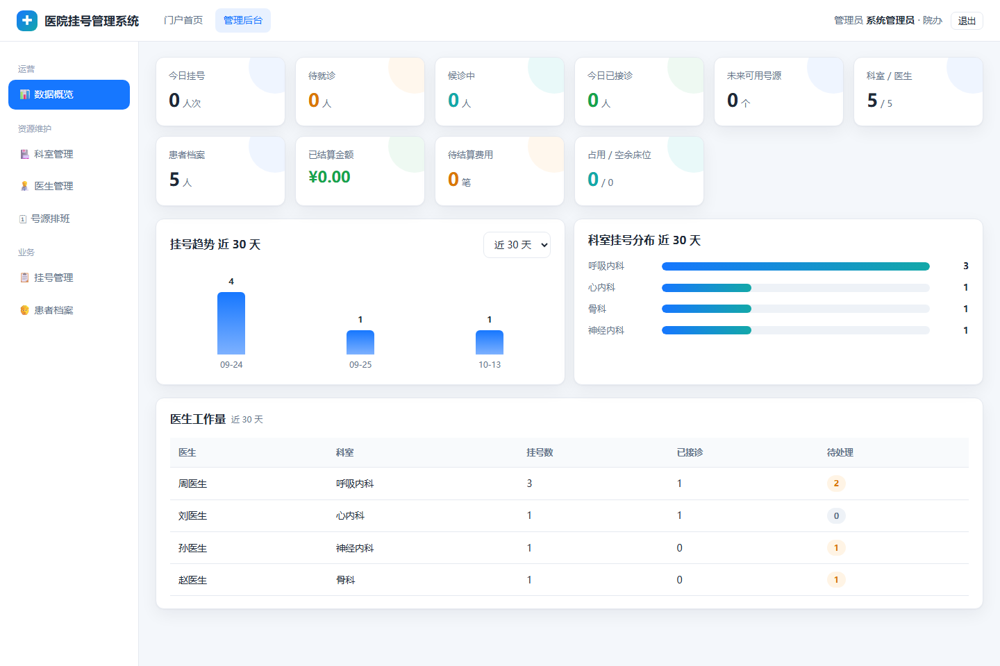

# HARS —— 医院挂号管理系统（Qt C++ 服务端 + 网页前端）

> 完整可运行的 B/S 医院挂号系统：**C++ 服务端**（Qt 6 `QHttpServer` + `QSqlDatabase` + MySQL 8）
> ＋ **5 个网页**（门户 / 登录 / 患者端 / 医生端 / 管理端）。
> 单一技术栈、单目录、双击即用。



---

## 一、怎么跑（3 步）

1. **MySQL 8.0 在跑**，数据库 `hospital_db` 存在
   （没建过：`mysql -uroot -p < sql\数据库初始化.sql`，会建 10 张表 + 演示数据）
2. 双击 **`HARS.bat`** → 输入 `1` → 服务启动，浏览器自动打开 `http://127.0.0.1:8080`
3. 用下面的账号登录（密码都是 `123456`）

| 角色 | 账号 | 说明 |
|---|---|---|
| 管理员 | `admin` | 后台全部功能 |
| 医生 | `doctor1` / `doctor2` | 刘医生（心内科）/ 周医生（呼吸内科），**只看和操作自己名下** |
| 患者 | `patient1` ~ `patient3` | 张东阳 / 王超毅 / 肖峻德，只能看自己的记录 |

> **数据库密码放在 `db.env`（不进 Git）**：第一次使用把 `db.env.example` 复制成 `db.env`，
> 填上你的 MySQL 密码即可；`HARS.bat` 启动时会自动读取。

---

## 二、`HARS.bat` 是唯一入口（原来的 4 个 bat 已合并）

| 编号 | 功能 |
|---|---|
| **1** | 启动服务（浏览器自动打开） |
| **2** | 停止服务 / 释放端口（**重新编译前必须执行**，否则会报 `ld returned 1 exit status`） |
| **3** | 查看访问链接（本机 / 局域网地址 / 服务状态 / 防火墙 / 当前 WiFi） |
| **4** | 放行防火墙（让同一局域网的其他设备能连，会弹 UAC） |
| **5** | 重新编译 |
| **6** | 接口自检（23 项） |
| **0** | 退出 |

也支持命令行直达：`HARS.bat 1`、`HARS.bat 3`、`HARS.bat 6`

---

## 三、目录结构

```
HARS/
├─ HARS.bat              唯一入口（启动/停止/链接/防火墙/编译/自检）
├─ HARS.pro              qmake 工程，TARGET = HARS
├─ src/
│  ├─ main.cpp           启动：连库 → 注册路由 → 托管静态文件 → 监听
│  ├─ appconfig / dbutil / authutil / staticfiles
│  └─ routes/            7 个业务模块，共 33 个接口
├─ public/               前端 5 个页面 + style.css + app.js
├─ build/                HARS.exe + MySQL 客户端库（编译产物）
├─ sql/
│  ├─ 数据库初始化.sql     10 张表 + 7 个外键 + 演示数据
│  └─ backup/            改结构前的数据库备份
├─ docs/screenshots/     6 张界面截图（给论文用）
├─ build.ps1             编译（自动找 .pro，自动释放端口）
├─ run.ps1               编译并启动
├─ check.ps1             接口自检（23 项）
└─ stop.ps1              释放端口
```

---

## 四、技术栈

| 层 | 技术 |
|---|---|
| 服务端 | C++17 + Qt 6.12 `QHttpServer` + `QSqlDatabase`（QMYSQL 驱动） |
| 前端 | 原生 HTML / CSS / JavaScript（零构建、零依赖，约 2000 行） |
| 数据库 | MySQL 8.0 / InnoDB / utf8mb4，10 张表、7 个外键、6 个唯一约束 |
| 编译 | qmake + MinGW（**必须 MinGW 套件**，MSVC 套件不带 MySQL 驱动插件） |

---

## 五、验证（`HARS.bat` 选 6，或 `powershell -File check.ps1`）

`ALL 23 CHECKS PASSED`，覆盖：

- 公开接口：`/api/health`、`/api/departments`、`/api/doctors`、`/api/schedules`、`/api/schedules/dates`
- 5 个网页全部返回 200
- 三种角色登录（admin / doctor1 / patient1）
- 管理员可访问：挂号记录、患者档案、4 个统计接口
- 权限守卫：无令牌 → 401、患者访问患者管理 → 403、错误密码 → 401、未知路径 → 404

写操作流程另外测过：挂号 → 重复挂号 409 → 取号 → 接诊 → 重复接诊 400 → 取消 → **号源余量还原** → 已取消不能再取号 400。

---

## 六、数据库要点

- **患者姓名**被多处冗余引用（挂号、病历、住院、费用、登录账号），改姓名时后端会**全库同步**，避免患者登录后看不到自己的记录
- **医生姓名**同理（号源、挂号、病历、住院、患者档案、登录账号一起改）
- 外键删除策略：历史单据 `SET NULL` 保留；医生名下有号源时 `RESTRICT` 不许删
- 完整的数据库设计说明见 `docs\数据库关系说明.md`，ER 图见 `docs\数据库ER图.png`

---

## 七、常见问题

| 现象 | 原因 / 解决 |
|---|---|
| 编译报 `can't open output file` / `ld returned 1 exit status` | 程序还在运行、exe 被占用 → `HARS.bat` 选 2 释放端口再编译 |
| 启动报端口被占用 | 同上，选 2 |
| 报 `QMYSQL driver not loaded` | 用错套件 —— 必须 MinGW 套件（MSVC 不带驱动插件） |
| 别的设备打不开 | `HARS.bat` 选 3 看状态：服务要「运行中」、防火墙要「已放行」、对方要连同一个 WiFi |
| 页面能开但没数据 | MySQL 没启动，或 `db.env` 里的数据库密码不对 |
